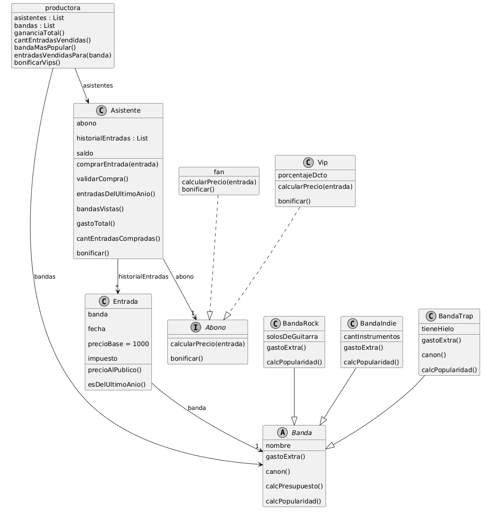

# tp-individual-objetos

**Polimorfismo:** Implementado en los abonos (fan y Vip) y en los tipos de bandas (BandaRock, BandaIndie y BandaTrap). Asistente y productora pueden interactuar con estos objetos usando los mismos mensajes; calcularPrecio(entrada) o calcPresupuesto(), sin tener que hacer if/else para verificar de qué tipo de objeto se trata.

**Composición y Delegación:** En vez de poner toda la lógica de los descuentos dentro de Asistente, cada asistente tiene un abono y este se encarga de calcular el precio final. De esta forma, cada abono maneja sus propias reglas y evito mezclar responsabilidades.

**Herencia, Sobreescritura y Uso de super():** Uso de clase padre `Banda` para tener en un solo lugar el comportamiento común y el valor base. Después, cada subclase redefine los cálculos que necesita según el tipo de banda. En el caso de BandaTrap, uso super() en el método canon() para aprovechar el cálculo de la clase padre y multiplicarlo por la popularidad de la banda, sin tener que repetir código.

**Encapsulamiento y Distribución de Responsabilidades:** Cada objeto se encarga de su propia información. Por ejemplo, las entradas validan su antigüedad, los asistentes calculan métricas a partir de su historial y las preferencias obtienen los datos que necesitan mediante mensajes públicos, sin tener que acceder directamente a los atributos internos de otros objetos.

**Manejo de Errores mediante Excepciones:** Para controlar las compras de entradas, implemente el método validarCompra(), que usa self.error("mensaje") cuando el saldo no alcanza. Así, si no se cumple una condición necesaria para realizar la compra, se interrumpe la operación en lugar de dejar que continúe y pueda generar un estado inconsistente.

## **Diagrama de clase**

